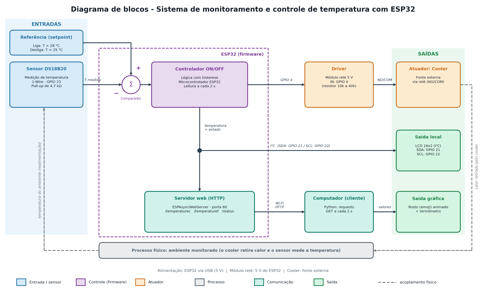
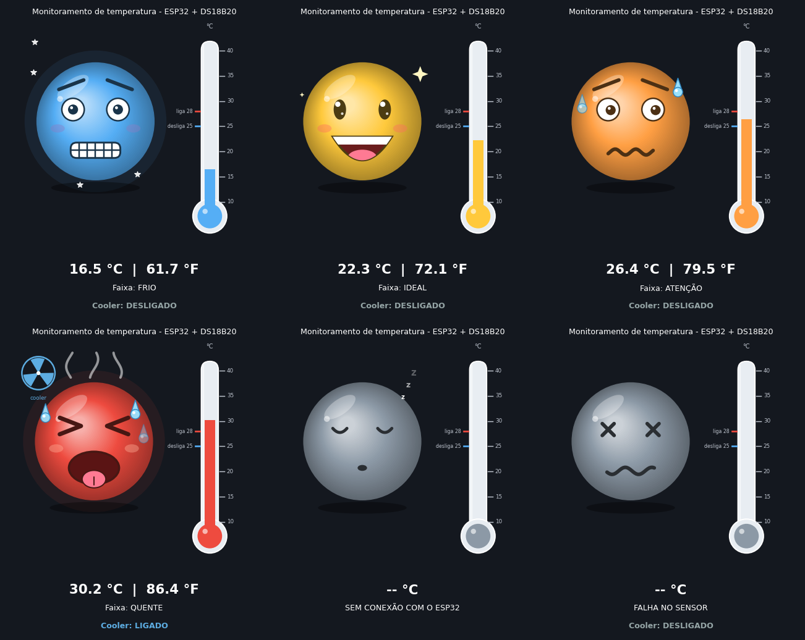

# Monitoramento de Temperatura com ESP32 + Computação Gráfica

Projeto Integrador (PI) da disciplina **Sistemas Embarcados** — UNASP
Prof. Robson Souza

**Integrantes:** _(preencher com os nomes do grupo)_

## O que o sistema faz

1. Um sensor **DS18B20** mede a temperatura e o **ESP32** a mostra em um **LCD 16x2**.
2. Se a temperatura passar de **28 °C**, o ESP32 liga o **cooler** (via módulo relé) e só o desliga abaixo de **25 °C** (controle ON/OFF com histerese).
3. O ESP32 publica os dados por **Wi-Fi** em um servidor web (HTTP).
4. Um programa em **Python** no computador consulta o servidor continuamente e anima um **rosto estilo emoji 3D** e um **termômetro** conforme a temperatura.



## Expressões do rosto

| Temperatura | Faixa | Expressão |
|---|---|---|
| < 20 °C | FRIO | azul, tremendo, dentes batendo, neve |
| 20 a 25 °C | IDEAL | amarelo, sorrindo, piscando, com brilhinhos |
| 25 a 28 °C | ATENÇÃO | laranja, preocupado, olhando de lado, suando |
| ≥ 28 °C | QUENTE | vermelho, língua de fora, vapor (cooler ligado) |
| — | sem conexão / falha no sensor | cinza, dormindo / olhos em X |



## Estrutura do repositório

```
├── firmware/monitoramento_esp32/   código do ESP32 (Arduino IDE)
├── src/
│   ├── cg_temperatura.py           programa de computação gráfica
│   └── mock_esp32.py               ESP32 simulado (testar sem o circuito)
├── docs/                           diagrama de blocos e imagens
├── .vscode/launch.json             configurações de execução (F5)
└── requirements.txt
```

## Hardware

| Componente | Ligação no ESP32 |
|---|---|
| DS18B20 (dados) | GPIO 23, com resistor pull-up de 4,7 kΩ para 3,3 V |
| Módulo relé (IN) | GPIO 4 (resistor de 10k a 40k em série), VCC em 5 V, GND |
| LCD 16x2 I²C | SDA no GPIO 21, SCL no GPIO 22 |
| Cooler | alimentado por fonte externa, ligado nos terminais COM/NO do relé |

> Se o módulo relé for ativo em nível alto, troque `RELE_LIGADO` e `RELE_DESLIGADO` no firmware.

## 1) Gravando o firmware no ESP32

1. Instale a **Arduino IDE** e o suporte à placa ESP32.
2. Instale as bibliotecas (*Sketch > Include Library > Manage Libraries*): **OneWire** (Paul Stoffregen), **DallasTemperature** (Miles Burton) e **LiquidCrystal I2C**.
3. Instale por *Add .ZIP Library*: **ESPAsyncWebServer** e **AsyncTCP**.
4. Abra `firmware/monitoramento_esp32/monitoramento_esp32.ino` e **troque `ssid` e `password`** pelos da sua rede (não envie a senha real para o GitHub).
5. Grave no ESP32, abra o *Serial Monitor* (115200) e anote o **endereço IP** mostrado.

Rotas do servidor: `/` (página), `/temperaturec`, `/temperaturef`, `/status`.

## 2) Rodando o programa gráfico (VS Code)

Requer Python 3.9 ou superior.

```bash
python -m venv .venv
# Windows:      .venv\Scripts\activate
# Linux / Mac:  source .venv/bin/activate
pip install -r requirements.txt
```

**Sem o circuito (simulado):**

```bash
python src/cg_temperatura.py --sim
```

**Com o ESP32 real** (computador na mesma rede Wi-Fi):

```bash
python src/cg_temperatura.py --ip 192.168.0.50
```

No VS Code, também dá para apertar **F5** (ou *Run and Debug*) e escolher **Simulado** ou **ESP32 real**.

## Tecnologias

ESP32 · DS18B20 · Arduino (C++) · ESPAsyncWebServer · Python · matplotlib · requests
